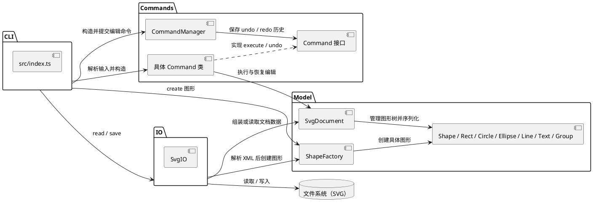
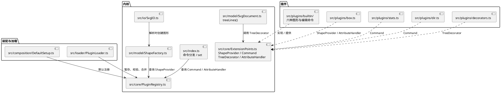

# SVG CLI 编辑器项目文档

## Phase 1：基础架构与模式

本项目实现一个命令行 SVG 编辑器。用户通过 REPL 输入命令，程序在内存中维护 SVG 文档与图形树，编辑操作通过命令对象执行并支持撤销、重做；SVG 文件解析和写入由 IO 模块负责。

### 1.1 模块划分

```text
src/
├── index.ts                 # CLI REPL、参数解析、命令分发与错误提示
├── model/                   # SVG 文档、图形对象、容器树及工厂
│   ├── Shape.ts             # 抽象图形基类与通用属性/几何接口
│   ├── Rect.ts              # 矩形
│   ├── Circle.ts            # 圆
│   ├── Ellipse.ts           # 椭圆
│   ├── Line.ts              # 线段
│   ├── Text.ts              # 文本
│   ├── Group.ts             # 图形容器
│   ├── ShapeFactory.ts      # 内置图形的创建入口
│   └── SvgDocument.ts       # 画布、根节点、图形查找、树操作与 SVG 序列化
├── commands/                # 可撤销编辑命令与命令历史管理器
│   ├── Command.ts           # 命令接口
│   ├── CommandManager.ts    # 执行、撤销、重做历史
│   └── *Command.ts          # 各具体编辑命令（一类一文件）
└── io/
    └── SvgIO.ts             # SVG XML 文件读取、解析、ID 补全及保存
```

模块依赖关系如下。CLI 负责组装对象并协调交互；命令调用文档/模型的公开操作；IO 使用模型和工厂构造文档。模型不依赖 CLI、命令管理器或 IO。



### 1.2 Command 模式

`src/commands/Command.ts` 定义统一的 `Command` 接口，包含 `execute(): void` 和 `undo(): void`。`CreateCommand`、`MoveCommand`、`SetCommand`、`ScaleCommand`、`GroupCommand`、`DeleteCommand`、`UngroupCommand`、`AddToCommand`、`FrontCommand` 和 `BackCommand` 等具体类封装各自的编辑行为及恢复所需的旧状态。

`CommandManager` 统一执行命令并维护两组历史：

1. `execute(command)` 先执行命令；成功后将其放入 undo 历史，并清空 redo 历史。失败的命令不会进入历史。
2. `undo()` 取出最近执行的命令并调用 `undo()`，然后将它移入 redo 历史。
3. `redo()` 取出最近撤销的命令并再次调用 `execute()`，再将它放回 undo 历史。

CLI 将可逆的图形编辑包装成具体命令再交给 `CommandManager`，这样命令历史只需理解统一接口，不必知道每种图形修改的细节。读取/保存、画布初始化和画布尺寸调整由 CLI/IO 直接处理，不作为普通编辑命令进入历史；IO 操作会设置 undo/redo 禁止标记，直到下一次成功的编辑命令清除该标记。

### 1.3 Composite 模式

`Shape` 是矩形、圆、椭圆、线、文本和组的共同抽象。每种具体图形实现自己的几何属性、移动/缩放行为和 SVG 输出。`Group` 本身也是 `Shape`，同时维护子图形列表；它可以包含普通图形或其他 `Group`，因此形成树形结构。

`SvgDocument` 管理根级图形，并提供按 ID 查找、插入/移除、父子位置维护、树形展示和序列化能力。对组执行移动或缩放会递归作用于其子图形。CLI 的 `tree`、`group`、`ungroup`、`addto` 和 `delete` 等操作均通过该树结构工作。`Group` 会阻止把自身或祖先放入后代，从而避免形成循环。

### 1.4 依赖方向规则

依赖方向约定如下：

```text
CLI (index.ts) ──> Commands ──> Model
      │                │
      ├──> IO ─────────┴──> Model / ShapeFactory
      └──> ShapeFactory ──> Model 图形
Model 不依赖 CLI、Commands 或 IO
```

命令层依赖模型来完成修改；CLI 依赖命令和模型的公共 API 来解析、构造和显示状态；IO 依赖模型/工厂把 XML 数据转换成文档，也把文档序列化为 SVG。模型保持最内层，不知道交互入口、文件格式解析器和历史管理器，这样几何对象和树结构不会受界面或存储细节牵连。`@xmldom/xmldom` 只由 IO 模块使用，XML 解析不散落在模型中。

当前按名称分派的位置只有两处：`src/index.ts` 将输入的命令名分发到命令处理函数，`src/model/ShapeFactory.ts` 将图形类型名映射到具体图形类。它们是本阶段明确的入口点；若后续命令或图形类型继续增长，可分别把分派表/注册机制独立出来，避免在 CLI 和工厂中不断扩展分支。

### 1.5 变化点与扩展方式

- **新增图形类型**：新增一个继承 `Shape` 的模型类，并在 `ShapeFactory` 中登记创建规则；需要支持 SVG 读写时，也在 `SvgIO` 中补充该类型的解析/序列化映射。`SvgDocument` 的树管理基于 `Shape`，不必为每个新叶子类型复制容器逻辑。
- **新增编辑命令**：新增实现 `Command` 接口的命令类，在构造时保存执行所需数据和 undo 所需旧状态；CLI 只需增加解析分支并提交给 `CommandManager`，历史管理机制不变。
- **新增存储格式或解析细节**：集中在 `io/` 实现，避免把 XML 细节加入图形模型。
- **新增交互入口**：CLI 当前在 `index.ts` 中实现 REPL 和命令分发；如需增加其他界面，可复用 model、commands 和 io 的公共接口。

## 2. 与 AI 协作的过程记录

项目按阶段迭代完成：

1. **模型骨架**：先建立 `Shape`、具体图形、`Group`、`SvgDocument` 和 `ShapeFactory`，确定图形与容器树的基本结构。
2. **补齐 Command 模式**：检查作业要求时发现初始骨架尚未体现 undo/redo 所要求的 Command 模式，于是补上 `Command` 接口、`CreateCommand`、`MoveCommand` 和 `CommandManager`，并验证历史行为。
3. **接入 CLI**：实现 `svg>` REPL、命令分发、帮助信息和错误处理；再逐步加入创建、移动、撤销/重做、树展示等基础功能。
4. **补全图形编辑命令**：扩展图形类型和带引号文本解析，加入容器创建/移动、删除、解组、属性修改、缩放与层级顺序命令，并为编辑操作实现对应的可撤销命令。
5. **加入 SVG IO**：通过 `@xmldom/xmldom` 解析 SVG XML，支持读取、缺失 ID 自动补全和警告、保存、画布尺寸查看/修改以及 IO 后的撤销/重做限制。
6. **环境兼容调整**：将 CLI 启动方式从 Node 的实验性 TypeScript 类型剥离选项改为 `tsx src/index.ts`，并把 `tsx` 加入开发依赖，降低对较新 Node 实验功能的依赖。
7. **文档收尾**：对照现有目录和代码职责编写本文档，核对架构说明、模式落地方式和项目脚本。

AI 在过程中用于协助分析作业要求、搭建代码初始骨架和检查实现；具体设计与代码以工程内当前版本为准。

## 3. 架构一致性自查

### 3.1 模块划分是否一致

**一致。** 当前目录与方案对应：`src/model/` 放模型和工厂，`src/commands/` 放命令接口、管理器及具体命令，`src/io/SvgIO.ts` 隔离 XML 文件读写，`src/index.ts` 是 CLI 入口。六种内置类型（`rect`、`circle`、`ellipse`、`line`、`text`、`g`）均在模型层实现。没有发现需要记为架构偏差的目录变更。

### 3.2 依赖方向是否违反规则

**抽样检查未发现违反项。** 代表性依赖如下：

- `src/commands/MoveCommand.ts` 导入 `SvgDocument`/`Shape` 模型类型，不导入 CLI 或 IO。
- `src/io/SvgIO.ts` 导入 `ShapeFactory`、具体容器类型和 `SvgDocument`，负责将解析结果装配为模型；模型没有反向导入 `SvgIO` 或 XML 库。
- `src/index.ts` 导入 Commands、Model 和 IO，作为最外层入口协调它们。
- `src/model/` 内部的文档、图形及工厂可以相互协作，但没有对 `src/commands/`、`src/io/` 或 CLI 的反向依赖。

因此，当前实现符合上文的分层规则。新增 SVG 类型时需同步检查 `ShapeFactory` 和 `SvgIO` 的读入映射；新增命令时需在 CLI 命令分发处接入，不应把 CLI 逻辑移入模型层。

## 4. 质量保证手段

### 4.1 静态类型检查

工程提供以下脚本：

```bash
npm run typecheck
```

该脚本执行 `tsc --noEmit`，检查 TypeScript 类型和模块引用，不生成构建文件。`typescript`、`@types/node` 和 `tsx` 是开发依赖；CLI 通过 `npm run cli` 启动。

### 4.2 终端会话检查

开发期间通过真实终端会话检查 REPL 输入、状态变化、撤销/重做和错误提示。已覆盖的典型功能路径包括：创建/移动后查看树并 undo/redo；对图形执行 group、set、delete 并撤销；缺参数、无效 id 等错误保持 REPL 可继续使用；读取含缺失 id 的 SVG 并检查警告；保存后重新读取，以及 IO 后 undo/redo 被禁止、编辑后重新解禁。下面给出代表性的图形编辑会话 transcript：

```text
svg> init 800 600
canvas 800x600 created
svg> create rect r1 10 20 100 50
rect#r1 created
svg> move r1 10 10
rect#r1 moved by (10,10)
svg> tree
svg (800x600)
└── rect#r1  x=20 y=30 w=100 h=50
svg> undo
undid last command
svg> tree
svg (800x600)
└── rect#r1  x=10 y=20 w=100 h=50
svg> redo
redid last command
svg> tree
svg (800x600)
└── rect#r1  x=20 y=30 w=100 h=50
svg> exit
bye
```

终端 transcript 用于人工核对程序实际输出和关键状态；类型检查与交互检查互相补充。本项目当前以这些命令行检查为质量手段，`package.json` 未配置自动化测试脚本，因此回归检查依赖重复运行的 CLI 会话和人工核对。

```bash
npm run cli
```

启动后输入 `help` 查看命令，输入 `exit` 或按 `Ctrl+C` 结束会话。

---

# Phase 2：插件式重构与 VSCode 扩展

## 第一部分：VSCode SVG 扩展实践

### 1. 功能概述

扩展为 VSCode Explorer 中的 `.svg` 文件添加 `[]` 标记。标记是文件装饰信息，不会修改文件名或文件内容；普通文件和目录不添加标记。

打开 SVG 文件时，扩展在 VSCode 原生 Outline 视图展示 XML 元素层级，包括根元素、容器和叶子。节点显示标签名；存在 `id` 时显示为 `标签名#id`。选择节点会定位到对应源码。文档编辑后，大纲随内容更新；编辑过程中的 XML 暂时不完整时可以清空大纲，但扩展应继续运行。

### 2. VSCode 与扩展的职责

VSCode 提供扩展运行环境和 Extension API。扩展负责注册自身功能、判断哪些文件适用，并按 API 约定返回装饰或符号数据。

扩展启动时通过 `activate` 注册文件装饰提供器和 Document Symbol Provider。VSCode 在 Explorer 需要展示文件时调用装饰提供器；打开或更新 SVG 文档时调用符号提供器。符号提供器解析文档并返回包含名称、类型、源码范围和父子关系的符号树。VSCode 再负责渲染 Outline、维护编辑器与视图交互，并在用户选中符号时导航到相应源码位置。

因此，扩展不自行绘制 Explorer 或 Outline 面板，也不直接接管编辑器导航；它向 VSCode 提供数据，由 VSCode 按 Extension API 的生命周期和调用约定消费这些数据。

### 3. 文件装饰与 Decorator、Adapter 模式

文件装饰与经典 Decorator 模式有相似之处：它在既有文件展示旁增加附加信息，同时不改变文件本身。扩展组合 VSCode 的文件身份和装饰元数据，VSCode 将元数据显示在 Explorer 中。

两者并不完全相同。经典 Decorator 通常包装一个对象，实现与被包装对象相同或兼容的接口，并在调用前后增强其行为。VSCode 文件装饰通过专用 API 返回 decoration 元数据，扩展并没有包装文件对象，也没有替代或代理文件系统对象。因此，它更适合描述为“具有装饰效果的 Extension API 功能”，而不是对经典 Decorator 模式的直接实现。

它也有 Adapter 的相似点：扩展将 `.svg` 文件这一领域判断映射为 VSCode 所需的装饰数据格式，遵循 VSCode 的扩展接口供宿主调用。但它没有把一个现有接口完整转换为另一个接口，也没有包裹文件系统。因此，这种对应是职责和交互方式上的类比，而非标准 Adapter 结构的严格落地。

关键调用关系是：扩展向 VSCode 注册提供器；VSCode 在需要装饰信息时调用提供器；提供器返回标记数据；VSCode 将标记叠加到 Explorer 的显示上。文件内容与文件名保持不变。

### 4. 与 Phase 1 代码的复用评估

Phase 1 的 SVG 模型和部分 XML 解析思路可以为 Outline 提供参考：两者都需要理解元素、属性、ID 和父子层级。若解析器能以独立、平台无关的模块形式提供纯文本到结构数据的转换，扩展可以复用这一部分逻辑。

CLI 的 `SvgDocument` 和图形模型不适合直接作为 Outline 的数据源。CLI 模型服务于编辑命令、几何属性、撤销历史和 SVG 序列化；Outline 需要保留 XML 元素的源码范围，以便 VSCode 将符号选择定位回文档。两种用途的数据结构和生命周期不同。

Phase 1 的 `SvgIO` 也不适合直接复用。它负责命令行环境下的文件读取、写入和模型装配；VSCode 扩展通过 TextDocument 获取当前缓冲区文本，包含尚未保存的编辑内容，并由 VSCode 管理文档生命周期。两者的 IO 边界不同。

此外，VSCode 扩展运行在独立的 Extension Host 进程中，通过 Extension API 与编辑器交互；它不依赖 CLI 的 REPL、`CommandManager`、当前工作目录或文件读写入口。因此，复用重点应放在可独立调用的 XML 解析规则或通用数据转换，而不是复用 CLI 的启动流程、命令层或文件 IO。解析不完整 XML 时，扩展应捕获解析异常并返回空符号结果，使 VSCode 继续保持响应。

## 第二部分：插件实践与插件式重构

### 1. 阶段目标与范围

Phase 2 包含两项实践：一个 VSCode SVG 扩展，以及对 Phase 1 CLI 的插件式重构。CLI 保留 Phase 1 的命令语义和默认输出，并通过扩展点支持新增图形、命令、树装饰和属性行为。

当前实现包含四个内核扩展点、默认代码装配、配置式插件加载，以及 `box`、`stats`、`dir` 和树装饰器。`dir` 通过文件系统适配器访问当前工作目录；`stats` 按图形树的先序深度优先顺序统计叶子和容器。

### 2. 扩展点清单

| 接口 | 职责 | 内核调用位置 | 当前实现 | 禁用可选扩展时的缺省行为 | 违约报错 |
|---|---|---|---|---|---|
| `ShapeProvider` | 根据图形类型创建图形对象 | `src/model/ShapeFactory.ts`：`ShapeFactory.create()` | 默认装配注册 `rect`、`circle`、`ellipse`、`line`、`text`、`g`；`BoxShapeProvider` 注册 `box` | 未注册类型时报告未知图形类型；六种默认图形仍由 `DefaultSetup` 注册 | 未注册类型抛出 `unknown shape type`；同类型重复注册抛出重复注册错误 |
| `Command` | 提供命令名、帮助说明和参数执行入口 | `src/index.ts`：命令分发函数；`PluginRegistry.getCommand()` | 默认命令适配器，以及 `StatsCommand`、`DirCommand` | 命令未注册时报告 `unknown command`；无插件时默认命令仍可用 | 重复命令名在注册时抛错；参数契约由命令实现检查并报告 `usage` 错误 |
| `TreeDecorator` | 为树中节点返回行尾标签 | `src/model/SvgDocument.ts`：`treeLines()` / `appendTree()` | `BoxTypeDecorator`、`ModifiedStarDecorator` | 空装饰器链不改变 Phase 1 树输出 | 装饰器异常由调用方的命令错误处理捕获；注册名重复时抛错 |
| `AttributeHandler` | 为特定图形和属性提供领域语义 | `src/index.ts`：`setAttribute()` 查询处理器后执行 | `BoxAttributeHandler` 处理 box 的 `fill` 和 `label` | 没有处理器命中时沿用原有 `SetCommand` 属性规则 | 不支持的属性按原属性验证报错；修改经 undo 命令执行，异常修改不会入历史 |

四个接口定义在 `src/core/ExtensionPoints.ts`。注册表位于 `src/core/PluginRegistry.ts`，负责保存扩展实例、按名称查询以及检查重复注册。

### 3. 装配方式

#### 3.1 代码装配

默认启动由 `src/composition/DefaultSetup.ts` 创建注册表并注册六种内置图形、内置命令适配器、box 属性处理器和树装饰器。`src/index.ts` 提供运行时命令处理器和文档访问上下文，再将注册表交给 `ShapeFactory`、`SvgIO` 和 CLI 分发逻辑。

代码装配适合默认能力：依赖关系由 TypeScript 明确表达，应用启动时创建一次注册表。新增代码装配插件需要在组合根增加注册代码。

#### 3.2 配置装配

CLI 启动参数包含 `--config <路径>` 时，入口调用 `PluginLoader` 读取配置并装入插件。配置中的模块按数组顺序加载；`enabled: false` 的项跳过；`options` 传给插件的 `activate`。相对模块路径和显式 `manifest` 路径以配置文件目录为基准。

例如当前 `dir` 插件配置：

```json
{
  "plugins": [
    {
      "module": "./src/plugins/dir-plugin.ts",
      "manifest": "./src/plugins/dir-plugin.package.json"
    }
  ]
}
```

`src/plugins/dir-plugin.package.json` 声明该插件注册的命令：

```json
{
  "name": "svg-editor-plugin-dir",
  "contributes": {
    "commands": ["dir"]
  }
}
```

Loader 在独立暂存注册表中激活插件，比较 manifest 中声明的扩展与实际注册内容；校验通过后才合并到主注册表。缺失模块、无默认导出、manifest 不匹配、激活失败和重复注册会输出以 `error:` 开头的信息，并继续处理后续插件。失败插件的暂存注册不会进入主注册表。

### 4. 依赖结构

#### 4.1 重构前：集中式分派与类型耦合

Phase 1 的 CLI 入口通过 `switch` 分发命令，`ShapeFactory` 通过 `switch` 创建图形。添加命令或图形类型需要修改既有分派点；IO 和文档模型也直接引用具体图形类。

```plantuml
@startuml
package "CLI / 组合根" {
  component "src/index.ts\n命令 switch" as CLI
}
package "命令层" {
  component "具体命令类" as Commands
  component "CommandManager" as Manager
}
package "模型层" {
  component "ShapeFactory\n类型 switch" as Factory
  component "SvgDocument" as Document
  component "具体图形类" as Shapes
}
package "IO" {
  component "SvgIO\nXML 解析与序列化" as IO
}

CLI --> Commands : 按命令名选择
CLI --> Manager
CLI --> Factory : create
Commands --> Document
Factory --> Shapes : 按类型直接构造
IO --> Factory : 读回时创建
Document --> Shapes : 直接识别和遍历
@enduml
```

#### 4.2 重构后：扩展点与注册表

重构后，工厂和命令入口通过注册表访问扩展实现。默认装配和配置加载器在组合根一侧负责创建、校验和注册插件。插件实现扩展点接口，内核不需要按新插件名称增加分支。



### 5. 关键实现说明

#### 5.1 `stats`

`StatsCommand` 读取当前 `SvgDocument`，按照画布子节点顺序进行深度优先遍历。容器只增加 `containers` 计数；叶子按首次出现的类型顺序累计，`total` 为叶子数量。统计是只读命令，不使用 `CommandManager`，因此不进入 undo 历史。

#### 5.2 `dir` 与适配器模式

`FileSystem` 是 `dir` 命令需要的目标接口，定义 `readDirectory(path)`。`DirCommand` 只依赖该接口，不直接依赖 Node 文件系统 API。测试时可以注入实现相同接口的 Mock 文件系统，控制目录项、顺序和失败情况。

`NodeFileSystem` 是适配器：它把 Node `fs.readdirSync(..., { withFileTypes: true })` 返回的 `Dirent[]` 转换为命令所需的 `DirectoryEntry[]`。这样命令逻辑不依赖 Node 的具体返回类型，也能在生产环境读取真实工作目录。

`dir` 包含隐藏项；目录排在文件之前，每组按名称排序。空目录输出 `(empty directory)`；读取失败输出 `error: cannot read directory: <path>`。命令不要求存在 SVG 文档，也不改变文档或 undo/redo 状态。

#### 5.3 `box`

`BoxShapeProvider` 创建一个复合 `Group`，其中包含矩形 `<id>-rect` 和文本 `<id>-label`。对新增子树的 ID 冲突检查由 `SvgDocument.add()` 在插入前完成；因此容器或任一子部件 ID 冲突时，创建不会留下部分插入的对象。

Box 序列化为带 `data-kind="box"` 的 `<g>`。当前 box 的 `fill` 和 `label` 由 `BoxAttributeHandler` 转译为对子部件的 `SetCommand`：`fill` 更新内部矩形，`label` 更新内部文字。每次 `set` 只提交一个撤销命令，所以一次 undo 恢复对应的整个属性修改。

### 6. ADR：架构决策记录

#### ADR-001：属性扩展点契约与 undo 粒度

**决策：**`AttributeHandler.handles(shapeId, attribute)` 仅判断处理器是否负责目标图形与属性。`apply` 返回一个既有 undo 命令，由 CLI 交给 `CommandManager` 执行。

Box 的 `fill` 映射到 `<id>-rect` 的 `fill`；Box 的 `label` 映射到 `<id>-label` 的 `text`。这避免 `SetCommand` 内增加针对 box 的分支。每个处理器只返回一个 undo 命令，因此一次 `set` 是一个 undo 单元；处理失败时，命令执行失败，不应加入历史。

#### ADR-002：box 读回与未知语义

**决策：**未安装 box 插件时，box 的 SVG 表示仍是标准 `<g>` 加其矩形和文本子节点。未识别 `data-kind="box"` 的读入路径把它视为普通 `g`，保留子树内容而降级其 box 专属语义。

当前插件实现了写出 `data-kind="box"`，但读回时识别该标记并重建 `Box` 仍需在后续工作中接入 ShapeProvider 读回契约。因此，不能把“已安装插件后自动还原 Box 实例”视为当前已验证能力。重复 ID 或子树非法时应拒绝整个读入，不能通过降级绕过唯一性约束。

#### ADR-003：dirty 标记与祖先传播

**决策：**当前 `ModifiedStarDecorator` 使用实例字段维护一个全局 dirty 布尔值。任何成功的普通编辑命令都会将它置为 `true`；undo/redo 不清除；成功保存后置为 `false`。因此该实现采用“自上次保存后发生过编辑”的语义，而不是“当前内容与保存内容不同”的比较语义。

dirty 时，装饰器为每个图形节点行添加 ` *`，包括未直接修改的节点和祖先；SVG 根标题当前不接收 `Shape` 参数，因此不会添加星号。该选择简单且明确，但不能指出具体哪些节点被修改；后续若需精确追踪，可将状态扩展为按 ID 的集合。

#### ADR-004：配置校验与失败隔离

**决策：**每个插件先在独立暂存注册表中执行 `activate`。Loader 对比 manifest 与实际注册的类别和名称，只有完全匹配且无重复时才合并到主注册表。激活失败或清单不匹配时，暂存内容被丢弃，其他已成功插件继续运行。

### 7. 验证方式

项目提供以下检查：

```bash
npm run typecheck
npm test
npm run metrics
```

`npm test` 使用 `node:test` 覆盖 `dir` 的 Mock 文件系统、真实临时目录，以及 Loader 的模块缺失、默认导出缺失、manifest 不匹配、激活失败回滚和重复注册路径。

`npm run metrics` 从 `final` tag 与当前工作树读取 TypeScript 文件，生成 `docs/metrics/metrics.json`。圈复杂度为基于 `if`、`switch`、`case`、`catch`、三元和逻辑运算符的估算值，不等同于专用静态分析器给出的精确圈复杂度。