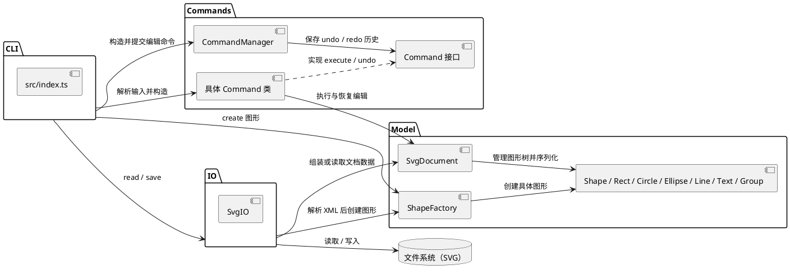

# SVG CLI 编辑器项目文档

## 1. 架构方案

本项目实现一个命令行 SVG 编辑器。用户通过 REPL 输入命令，程序在内存中维护 SVG 文档与图形树，编辑操作通过命令对象执行并支持撤销、重做；SVG 文件解析和写入由 IO 模块负责。

### 1.1 模块划分

```text
src/
├── index.ts                 # CLI REPL、参数解析、命令分发与错误提示
├── model/                   # SVG 文档、图形对象、容器树及工厂
│   ├── Shape.ts             # 抽象图形基类与通用属性/几何接口
│   ├── Rect.ts              # 矩形
│   ├── Circle.ts            # 圆
│   ├── Ellipse.ts           # 椭圆
│   ├── Line.ts              # 线段
│   ├── Text.ts              # 文本
│   ├── Group.ts             # 图形容器
│   ├── ShapeFactory.ts      # 内置图形的创建入口
│   └── SvgDocument.ts       # 画布、根节点、图形查找、树操作与 SVG 序列化
├── commands/                # 可撤销编辑命令与命令历史管理器
│   ├── Command.ts           # 命令接口
│   ├── CommandManager.ts    # 执行、撤销、重做历史
│   └── *Command.ts          # 各具体编辑命令（一类一文件）
└── io/
    └── SvgIO.ts             # SVG XML 文件读取、解析、ID 补全及保存
```

模块依赖关系如下。CLI 负责组装对象并协调交互；命令调用文档/模型的公开操作；IO 使用模型和工厂构造文档。模型不依赖 CLI、命令管理器或 IO。



### 1.2 Command 模式

`src/commands/Command.ts` 定义统一的 `Command` 接口，包含 `execute(): void` 和 `undo(): void`。`CreateCommand`、`MoveCommand`、`SetCommand`、`ScaleCommand`、`GroupCommand`、`DeleteCommand`、`UngroupCommand`、`AddToCommand`、`FrontCommand` 和 `BackCommand` 等具体类封装各自的编辑行为及恢复所需的旧状态。

`CommandManager` 统一执行命令并维护两组历史：

1. `execute(command)` 先执行命令；成功后将其放入 undo 历史，并清空 redo 历史。失败的命令不会进入历史。
2. `undo()` 取出最近执行的命令并调用 `undo()`，然后将它移入 redo 历史。
3. `redo()` 取出最近撤销的命令并再次调用 `execute()`，再将它放回 undo 历史。

CLI 将可逆的图形编辑包装成具体命令再交给 `CommandManager`，这样命令历史只需理解统一接口，不必知道每种图形修改的细节。读取/保存、画布初始化和画布尺寸调整由 CLI/IO 直接处理，不作为普通编辑命令进入历史；IO 操作会设置 undo/redo 禁止标记，直到下一次成功的编辑命令清除该标记。

### 1.3 Composite 模式

`Shape` 是矩形、圆、椭圆、线、文本和组的共同抽象。每种具体图形实现自己的几何属性、移动/缩放行为和 SVG 输出。`Group` 本身也是 `Shape`，同时维护子图形列表；它可以包含普通图形或其他 `Group`，因此形成树形结构。

`SvgDocument` 管理根级图形，并提供按 ID 查找、插入/移除、父子位置维护、树形展示和序列化能力。对组执行移动或缩放会递归作用于其子图形。CLI 的 `tree`、`group`、`ungroup`、`addto` 和 `delete` 等操作均通过该树结构工作。`Group` 会阻止把自身或祖先放入后代，从而避免形成循环。

### 1.4 依赖方向规则

依赖方向约定如下：

```text
CLI (index.ts) ──> Commands ──> Model
      │                │
      ├──> IO ─────────┴──> Model / ShapeFactory
      └──> ShapeFactory ──> Model 图形
Model 不依赖 CLI、Commands 或 IO
```

命令层依赖模型来完成修改；CLI 依赖命令和模型的公共 API 来解析、构造和显示状态；IO 依赖模型/工厂把 XML 数据转换成文档，也把文档序列化为 SVG。模型保持最内层，不知道交互入口、文件格式解析器和历史管理器，这样几何对象和树结构不会受界面或存储细节牵连。`@xmldom/xmldom` 只由 IO 模块使用，XML 解析不散落在模型中。

当前按名称分派的位置只有两处：`src/index.ts` 将输入的命令名分发到命令处理函数，`src/model/ShapeFactory.ts` 将图形类型名映射到具体图形类。它们是本阶段明确的入口点；若后续命令或图形类型继续增长，可分别把分派表/注册机制独立出来，避免在 CLI 和工厂中不断扩展分支。

### 1.5 变化点与扩展方式

- **新增图形类型**：新增一个继承 `Shape` 的模型类，并在 `ShapeFactory` 中登记创建规则；需要支持 SVG 读写时，也在 `SvgIO` 中补充该类型的解析/序列化映射。`SvgDocument` 的树管理基于 `Shape`，不必为每个新叶子类型复制容器逻辑。
- **新增编辑命令**：新增实现 `Command` 接口的命令类，在构造时保存执行所需数据和 undo 所需旧状态；CLI 只需增加解析分支并提交给 `CommandManager`，历史管理机制不变。
- **新增存储格式或解析细节**：集中在 `io/` 实现，避免把 XML 细节加入图形模型。
- **新增交互入口**：CLI 当前在 `index.ts` 中实现 REPL 和命令分发；如需增加其他界面，可复用 model、commands 和 io 的公共接口。

## 2. 与 AI 协作的过程记录

项目按阶段迭代完成：

1. **模型骨架**：先建立 `Shape`、具体图形、`Group`、`SvgDocument` 和 `ShapeFactory`，确定图形与容器树的基本结构。
2. **补齐 Command 模式**：检查作业要求时发现初始骨架尚未体现 undo/redo 所要求的 Command 模式，于是补上 `Command` 接口、`CreateCommand`、`MoveCommand` 和 `CommandManager`，并验证历史行为。
3. **接入 CLI**：实现 `svg>` REPL、命令分发、帮助信息和错误处理；再逐步加入创建、移动、撤销/重做、树展示等基础功能。
4. **补全图形编辑命令**：扩展图形类型和带引号文本解析，加入容器创建/移动、删除、解组、属性修改、缩放与层级顺序命令，并为编辑操作实现对应的可撤销命令。
5. **加入 SVG IO**：通过 `@xmldom/xmldom` 解析 SVG XML，支持读取、缺失 ID 自动补全和警告、保存、画布尺寸查看/修改以及 IO 后的撤销/重做限制。
6. **环境兼容调整**：将 CLI 启动方式从 Node 的实验性 TypeScript 类型剥离选项改为 `tsx src/index.ts`，并把 `tsx` 加入开发依赖，降低对较新 Node 实验功能的依赖。
7. **文档收尾**：对照现有目录和代码职责编写本文档，核对架构说明、模式落地方式和项目脚本。

AI 在过程中用于协助分析作业要求、搭建代码初始骨架和检查实现；具体设计与代码以工程内当前版本为准。

## 3. 架构一致性自查

### 3.1 模块划分是否一致

**一致。** 当前目录与方案对应：`src/model/` 放模型和工厂，`src/commands/` 放命令接口、管理器及具体命令，`src/io/SvgIO.ts` 隔离 XML 文件读写，`src/index.ts` 是 CLI 入口。六种内置类型（`rect`、`circle`、`ellipse`、`line`、`text`、`g`）均在模型层实现。没有发现需要记为架构偏差的目录变更。

### 3.2 依赖方向是否违反规则

**抽样检查未发现违反项。** 代表性依赖如下：

- `src/commands/MoveCommand.ts` 导入 `SvgDocument`/`Shape` 模型类型，不导入 CLI 或 IO。
- `src/io/SvgIO.ts` 导入 `ShapeFactory`、具体容器类型和 `SvgDocument`，负责将解析结果装配为模型；模型没有反向导入 `SvgIO` 或 XML 库。
- `src/index.ts` 导入 Commands、Model 和 IO，作为最外层入口协调它们。
- `src/model/` 内部的文档、图形及工厂可以相互协作，但没有对 `src/commands/`、`src/io/` 或 CLI 的反向依赖。

因此，当前实现符合上文的分层规则。新增 SVG 类型时需同步检查 `ShapeFactory` 和 `SvgIO` 的读入映射；新增命令时需在 CLI 命令分发处接入，不应把 CLI 逻辑移入模型层。

## 4. 质量保证手段

### 4.1 静态类型检查

工程提供以下脚本：

```bash
npm run typecheck
```

该脚本执行 `tsc --noEmit`，检查 TypeScript 类型和模块引用，不生成构建文件。`typescript`、`@types/node` 和 `tsx` 是开发依赖；CLI 通过 `npm run cli` 启动。

### 4.2 终端会话检查

开发期间通过真实终端会话检查 REPL 输入、状态变化、撤销/重做和错误提示。已覆盖的典型功能路径包括：创建/移动后查看树并 undo/redo；对图形执行 group、set、delete 并撤销；缺参数、无效 id 等错误保持 REPL 可继续使用；读取含缺失 id 的 SVG 并检查警告；保存后重新读取，以及 IO 后 undo/redo 被禁止、编辑后重新解禁。下面给出代表性的图形编辑会话 transcript：

```text
svg> init 800 600
canvas 800x600 created
svg> create rect r1 10 20 100 50
rect#r1 created
svg> move r1 10 10
rect#r1 moved by (10,10)
svg> tree
svg (800x600)
└── rect#r1  x=20 y=30 w=100 h=50
svg> undo
undid last command
svg> tree
svg (800x600)
└── rect#r1  x=10 y=20 w=100 h=50
svg> redo
redid last command
svg> tree
svg (800x600)
└── rect#r1  x=20 y=30 w=100 h=50
svg> exit
bye
```

终端 transcript 用于人工核对程序实际输出和关键状态；类型检查与交互检查互相补充。本项目当前以这些命令行检查为质量手段，`package.json` 未配置自动化测试脚本，因此回归检查依赖重复运行的 CLI 会话和人工核对。

```bash
npm run cli
```

启动后输入 `help` 查看命令，输入 `exit` 或按 `Ctrl+C` 结束会话。
